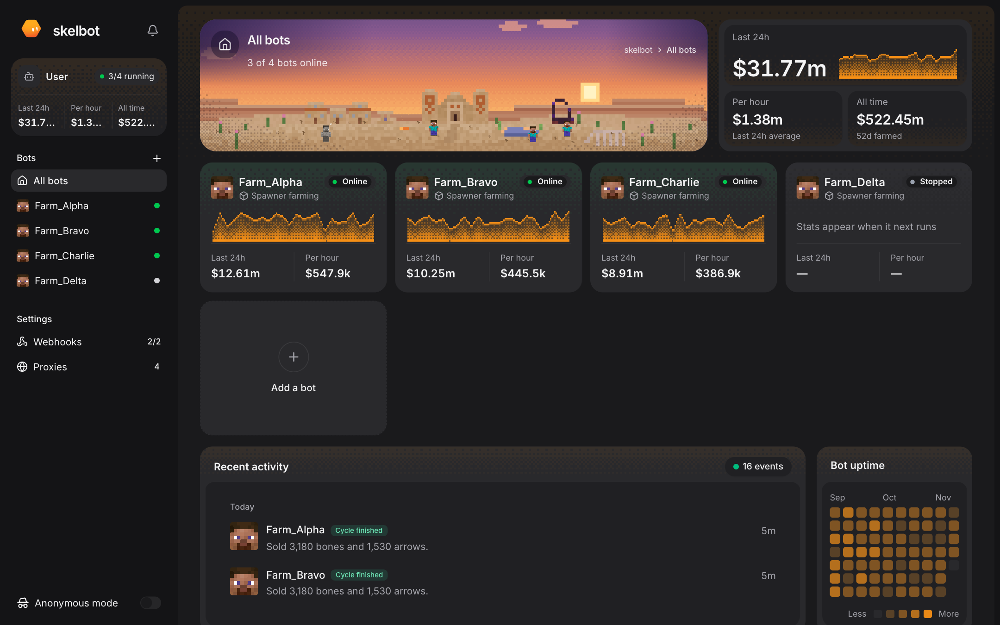
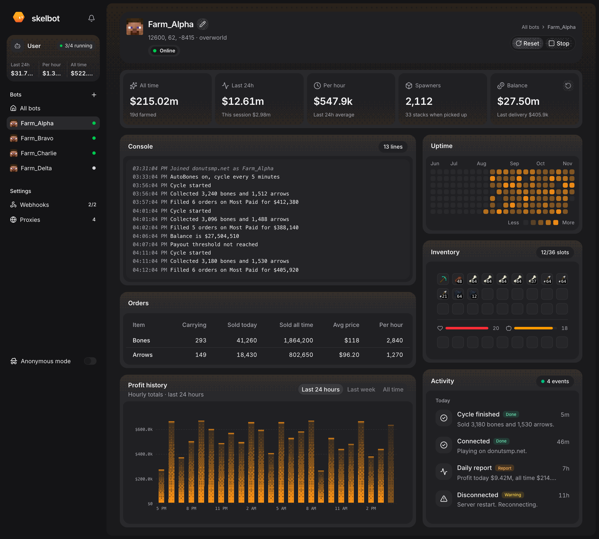
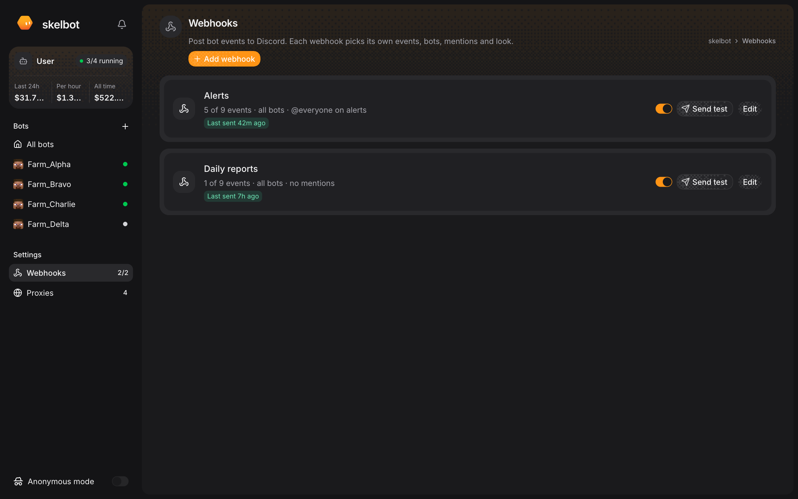
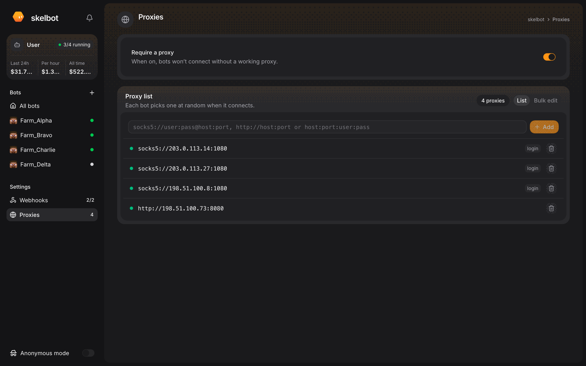

# skelbot

A bot manager for DonutSMP, built on Mineflayer. Run any number of accounts from a web dashboard that farms spawners, fills orders and tracks profit.



## Install

You need Node.js 22 or newer.

```bash
git clone https://github.com/WillMcKay/skelbot.git
cd skelbot
npm install
npm run build
npm start
```

Open http://localhost:3000, click **Add bot** and sign in with the Microsoft account the bot should use.

## Screenshots







## License

GPL-3.0. See `LICENSE`.
